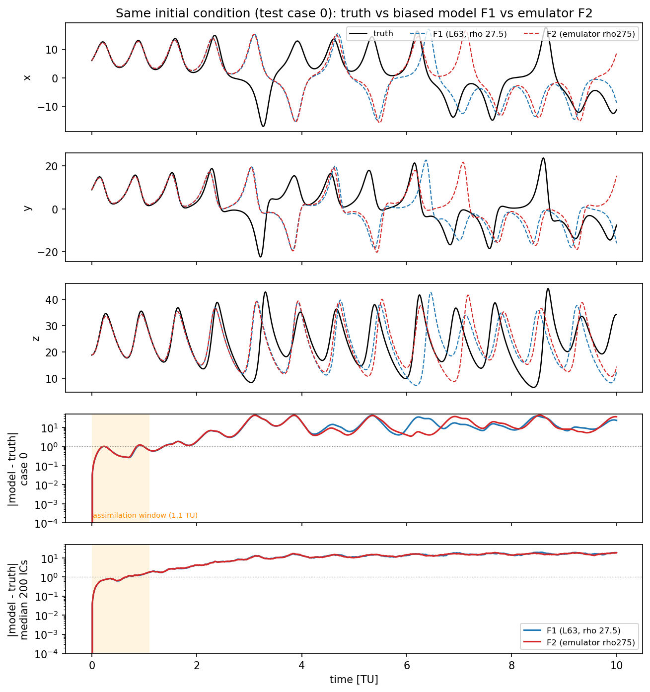
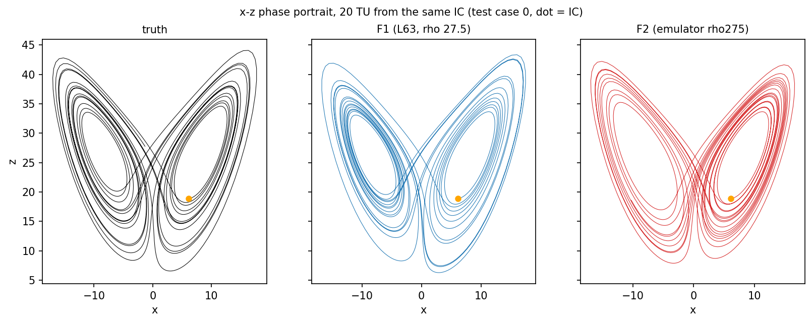
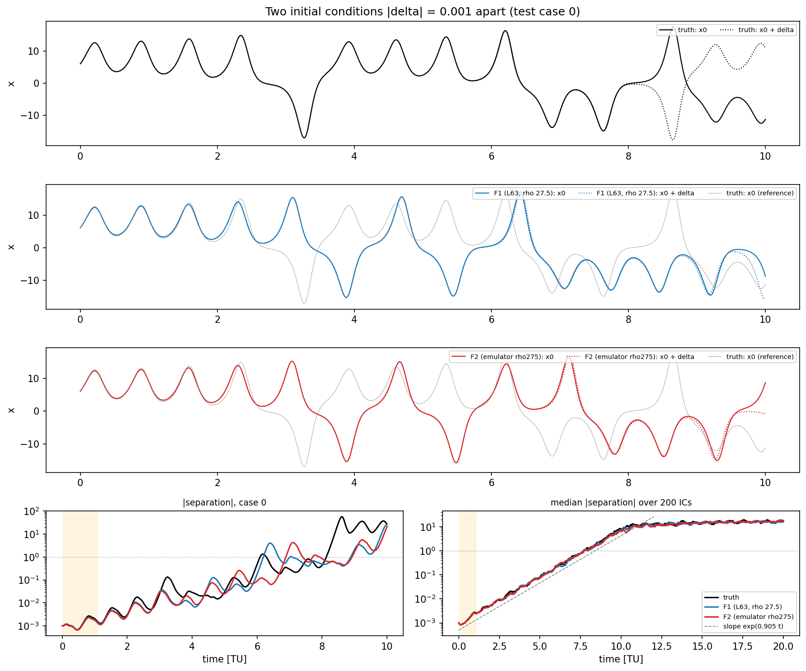
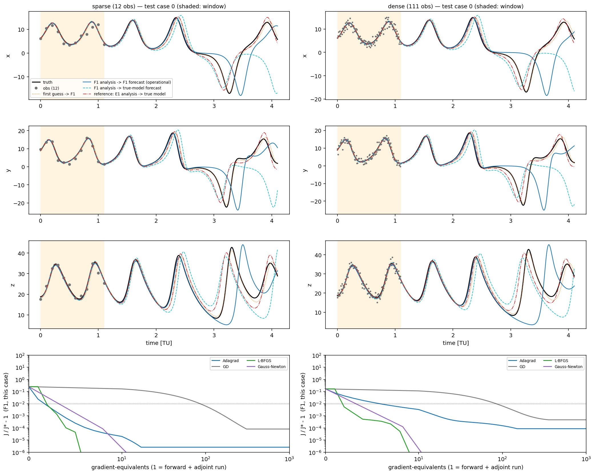
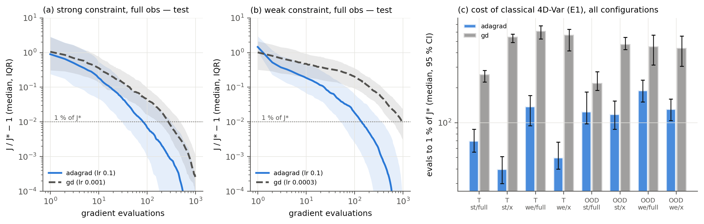
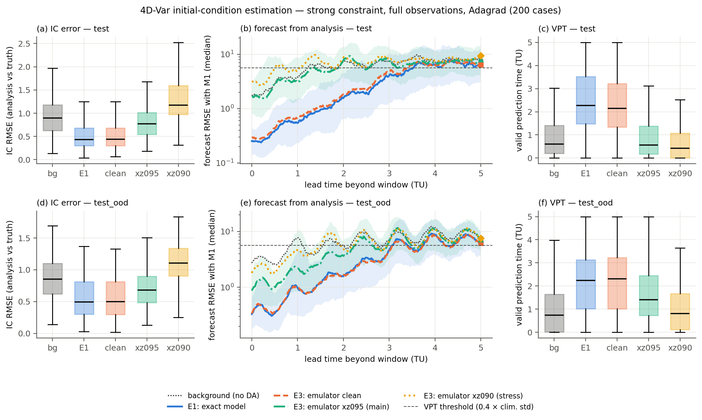
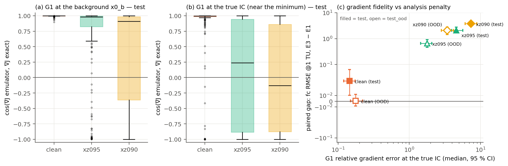
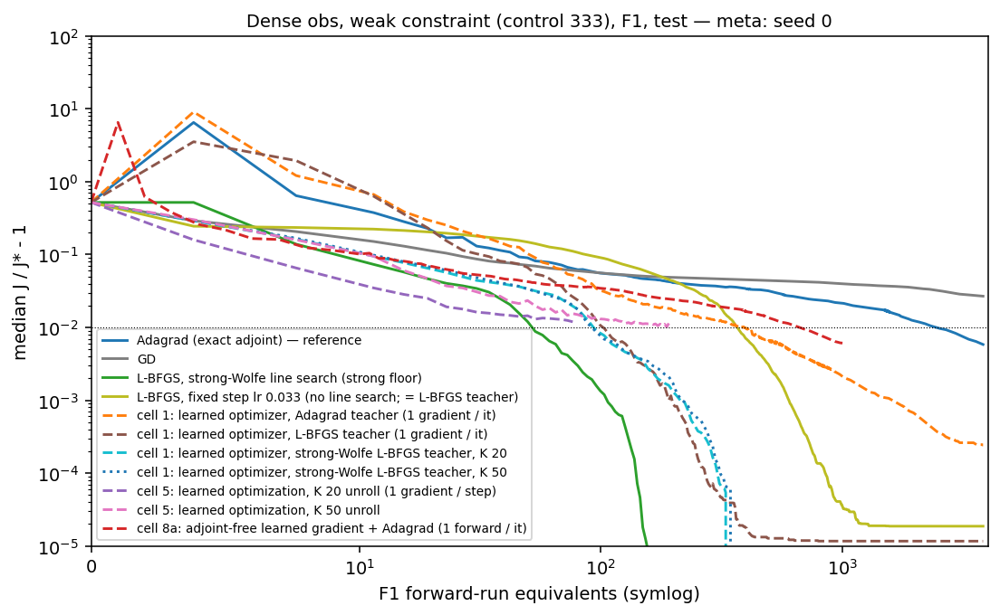

# dameta — Can a learned optimizer learn the geometry of 4D-Var?

Meta-learning inside a 4D-Var **initial-condition estimation** scheme, tested on Lorenz-63 under controlled model error.

---

## 1. Objective

A 4D-Var analysis is expensive because the minimization is iterative: every iteration needs a forward run of the model
and a backward run of its adjoint. This project inserts a **machine-learning module into the 4D-Var minimization**.
The module does not emulate the model. It learns the *optimization* itself (learning to optimize), and we ask:

> **Can a learned module learn the geometry of the 4D-Var problem?** That means the step lengths, the preconditioning,
> the local tangent-linear structure of the dynamics, and the curvature of the cost. If it can, does it give the same
> analysis as classical 4D-Var at a lower cost, and does it still work on initial conditions it has never seen?

Supporting questions:
- Does a learned optimizer beat its classical teacher (GD, Adagrad, L-BFGS)?
- Which inputs does it need (the running gradient, or only the state)?
- Can the adjoint be learned, so that each iteration needs only a forward run?
- How do these answers change when the model used inside 4D-Var is **wrong** (a biased model, or an ML emulator)?

---

## 2. Experimental setting

### 2.1 Three models

The truth is never used inside the estimation. Every inverse problem runs on a **false** model, so it carries model
error and nothing else.

| role | model | definition | used for |
|---|---|---|---|
| **truth** | Lorenz-63 | σ = 10, ρ = 28, β = 8/3; RK4, Δt = 0.01, float64 | truth trajectories, observations, evaluation |
| **false model F1** | knowledge numerical model | Lorenz-63 with **ρ = 27.5** (other parameters exact) | 4D-Var (BICE and BPE) |
| **false emulator F2** | ML emulator `rho275` | MLP tendency (3→64→64→3, SiLU) + RK4, trained on F1 trajectories (rollout loss, curriculum 1→10 steps) | 4D-Var (BICE) |
| reference E1 | truth model inside 4D-Var | perfect-model upper bound | reference only |

**Same initial condition.** Starting from the same state, F1 and F2 leave the truth (|error| > 1) after a median of
**0.36 TU**, which is inside the assimilation window. F2 follows F1 closely. All three models keep the butterfly
attractor.





**Slightly different initial conditions (|δ| = 10⁻³).** All three models have the same error-growth rate (leading
Lyapunov exponent ≈ 0.90 per TU, slope exp(0.905 t)) and the same predictability (~7.7 TU before the separation
saturates). The emulator reproduces the chaotic sensitivity of the model it imitates.



### 2.2 Data and observations

- **Assimilation window:** L = 1.1 TU = 110 steps. This is the Lyapunov time of the false model (1/λ₁ = 1.11 TU for F1,
  ≈ 1.16 TU for F2).
- **Observations of the truth:** y = H x_true + ε, ε ~ N(0, 2 I), R = 2 I.
  - sparse (default): every 10 steps (0.1 TU), **12 observation times**
  - dense: every step, **111 observation times** (nested with the sparse set)
  - patterns: full state (H = I) and x-only
- **Forecast verification:** 5 TU beyond the window.
- **Splits by initial condition:** train 1000 / val 200 / test 200 / **test_ood 200**. The test_ood ICs come from a
  held-out lobe-transition region (r_xy = √(x² + y²) < 3, while train/val/test have r_xy ≥ 4). Test ICs are never seen
  by the emulator or by meta-training.

### 2.3 First guess and background covariance

The first guess x₀ᵇ is **one member of a time-lagged ensemble of the false model**: the forecast launched from the true
state 0.5 TU before t₀, valid at t₀. It is a balanced state of the false model, never truth + white noise.
B is hybrid, **B = α B_ens + (1 − α) s² I**, where B_ens is the covariance of 10 lagged members (lags 0.1–1.0 TU).
(α, s²) = (0.25, 0.40) for F1 and (0.25, 0.45) for F2, fitted by maximum likelihood of the validation innovations
(χ² of the first-guess error: 3.2 on val, 3.4 on test; calibrated value 3).

### 2.4 4D-Var setup

| item | setting |
|---|---|
| **Strong constraint** | control x₀ (dim 3); J = ½‖x₀ − x₀ᵇ‖²_B⁻¹ + ½ Σᵢ ‖yᵢ − H M₀→ᵢ(x₀)‖²_R⁻¹ |
| **Weak constraint** | control (x₀, η₁ … η_N); model-error increments η added at observation times; J_q = ½ Σ ‖ηᵢ‖²_Q⁻¹, Q = σ_q² I, σ_q = 0.1 (dense: also 0.1/√10). Control dim 36 (sparse) / 333 (dense) |
| **BICE** | background initial-condition estimation (x₀ only), on F1 and F2 |
| **BPE** | joint parameter estimation [x₀, σ, ρ, β] on F1, Gaussian prior centred on F1's values (10 % std) |
| **Classical solvers** | GD, Adagrad (lr 0.3 strong / 0.1 weak), L-BFGS with strong-Wolfe line search (history 10), Gauss-Newton |
| **Adjoint-free baselines** | central finite differences of F1's cost; hybrid gradient (F1 cost, emulator adjoint) |
| **Learning rates** | pre-registered rule on val: lowest median final J, ties → fewer evaluations |
| **Stopping / budget** | ≤ 1000 iterations or relative ΔJ < 10⁻⁶ |
| **Cost metric** | model runs (or gradient evaluations) until **J ≤ 1.01 J\***, J\* = best final cost of the classical solvers on the same case and model; 1 gradient = 3.7–3.8 F1 forward runs / 2.5 F2 forward runs (measured) |

Case 0 of the test set, sparse vs dense observations. Top: truth, observations, F1 analysis and forecasts.
Bottom: classical convergence.



### 2.5 Meta setup

The learned module replaces or modifies the update x₀ᵏ⁺¹ = x₀ᵏ + g_θ(…). Its inputs are always the running state xᵏ,
the iteration k and, where stated, the running gradient ∇J(xᵏ). It **never** sees the background or the truth.
Each learner is trained on the 1000 training ICs of its own false model (3 seeds, best epoch on val), then **frozen**
and applied to test and test_ood.

| cell | family | training signal | inputs | model cost / iteration |
|---|---|---|---|---|
| 1 (**Meta-B**) | learned optimizer: rescales the teacher step with a bounded per-component stretch, K = 20 network sub-steps | unsupervised, Δ inner loss (first-order ΔJ along the move) | x, ∇J, k | 1 gradient |
| 2 | learned optimizer | supervised, 5-step teacher lookahead | x, ∇J, k | 1 gradient |
| 3 | learned optimizer | unsupervised, one-step J decrease | x, k (± obs) | 1 forward run |
| 4 | learned optimizer | supervised, teacher's gradient | x, k (± obs) | 1 forward run |
| 5 (**Meta-A**) | learned optimization: free update unrolled K = 20 (also 5–50) | unsupervised, J(x^K) | x, ∇J, k | 1 gradient (K total) |
| 7 | learned optimization, amortized | unsupervised, J(x^K) | x, k (± obs) | none |
| 8 v1 | adjoint-free learned gradient (+ Adagrad), plain MLP | supervised on the emulator's ∇J_o | x, innovations, k | 1 forward run |
| **8a** | adjoint-free learned gradient, **adjoint-structured**: learns the one-interval tangent-linear operator A_θ(x) = I + MLP(x) and forms ∇J_o with the exact adjoint recursion | supervised on the emulator's one-interval Jacobians | forward-run states, residuals | 1 forward run |

Teachers for cell 1: Adagrad (default), fixed-step L-BFGS, and strong-Wolfe L-BFGS (the reference method itself).

### 2.6 Evaluation

Against the truth: IC RMSE; forecast RMSE at 1 TU after the window, both with the **true model** (IC quality) and with
the **estimation model** (operational); cost to 1 % / 5 % of J\*; fraction of cases reaching the target; "worse basins"
(final J > 1.1 × reference); gradient fidelity G1 = cos(g_method, ∇J_true). Statistics: medians over 200 cases,
95 % bootstrap CIs, comparisons paired by case, 3 training seeds reported with their spread.

---

## 3. Results by branch

Each milestone was developed on its own branch. Raw records, tables and figures live in each branch's `tmp/`
(git-ignored). The figures used here are copied into `docs/figures/`. Paper-ready write-ups are in
`memory/findings.md` and `memory/branches/<branch>/findings.md`.

> M2–M4 used the first data set (D1 v1): window 1 TU, 11 observations, background = truth + N(0, I), and, for M3, a
> deliberately degraded emulator (`xz095`: 5 % of the −xz term of dy/dt removed). M5 uses the model-error-isolated
> setting of §2 (D1 v2).

### `main` — M1: model, data, gradient checks
Lorenz-63 + RK4 in float64, seeded data generator (NetCDF), held-out test_ood region. Tangent-linear/adjoint
dot-product tests and finite-difference vs autodiff checks pass (11/11).

### `m2-classical-4dvar` — E1: classical 4D-Var with the exact model
- Strong-constraint 4D-Var halves the background IC error (0.43 vs 0.90, test) and extends the valid prediction time
  from 0.6 to 2.3 TU. No case diverges.
- Adagrad reaches 1 % of J\* in **70** gradients against 261 for GD. The gap grows for weak constraint and x-only
  observations (up to 14×). test_ood is harder (125 gradients).



### `m3-emulator` — E3: 4D-Var through an emulator
- A clean emulator is nearly a drop-in replacement (forecast penalty at 1 TU: 0.035; test_ood: indistinguishable from 0).
- A degraded emulator (`xz095`) still forecasts 1.6 TU from the true state, but the analysis degrades sharply:
  IC error 0.43 → 0.77, forecast penalty **+2.09** at 1 TU, 89 % of cases worse.
- Mechanism: the emulator gradient is accurate far from the minimum (cos 0.98 at the background) but loses its
  direction near it (cos 0.24 at the true IC). 4D-Var converges quickly to the minimum of a *different* cost.




### `m4-meta-b` — E2-B: Meta-B (Δ inner-loss learned optimizer) on the exact model
- **7.4× fewer gradients than Adagrad** on test (9.5 vs 70), 4.2× on test_ood (29.5 vs 125), and the target is
  reached in more cases (0.97 vs 0.92). Seed spread ± 0.5 gradient.
- The analysis error is equal or lower (0.419 vs 0.429), but the forecast at 1 TU is +10 % (test) / +17 % (test_ood).
  The North Star gate (≤ 1/10 cost **and** forecast within 5 %) is **not met**.
- What it learned: a step-length stretch of 5–8× over the Adagrad step, i.e. a state-dependent preconditioner of the
  training region. The speed-up shrinks out of distribution.

### `m5-meta-grid` — Meta grid under model error (F1 / F2, §2 setting)

**Classical, effect of model error (test, strong, sparse full obs).** With either false model, 4D-Var stalls at
IC RMSE 0.42 vs 0.33 with the true model (first guess 0.645). The F2 emulator matches F1 inside 4D-Var (0.419 vs 0.425).
BPE recovers ρ ≈ 27.8 and cuts the true-model forecast error by 30 %, at ~10× the cost. Finite differences or the
emulator's adjoint lose no quality but run at about half the speed.

**Meta grid vs the reference (Adagrad + exact adjoint, same false model; test, strong / full; 3 seeds).**

| cell | F1 speed-up (model runs) | reached (ref 0.99) | IC RMSE (ref 0.425) | true-model fc vs ref |
|---|---|---|---|---|
| 1 — learned optimizer (Δ) | ×1.13 (retuned: ×1.28) | 0.84 (0.97) | 0.453 (0.423) | +16 % (+2 %) |
| 2 — supervised lookahead | ×0.77 | 0.51 | 0.440 | +51 % |
| 5 — learned optimization K 20 | ×1.30 | 0.62 | 0.472 | **−4 %** |
| 7 — no model run | — | 0.07 | 0.519 | +61 % |
| 3, 4 — no gradient input | diverge | ≤ 0.12 | 6–38 | — |
| 8 v1 — unstructured learned gradient | diverges | 0.07 | 3.9 | — |
| **8a — adjoint-structured learned gradient** | **×3.66 (wall-clock ×2.94)** | **1.00** | **0.418** | **−1 %** |

Cell 8a holds in **all four configurations** (strong/weak × full/x-only), on test and test_ood, for both F1 and F2:
wall-clock ×2.3–2.9, IC error within ±0.01 of the reference, forecast within ±2 %. Its gradient is as faithful to the
true sensitivity as the exact false-model adjoint (G1 cos 0.990 vs 0.992).

**Classical floor.** L-BFGS with a line search needs only 5.5–6 gradients (×1.7–1.8 over Adagrad, no training). The
headroom for a learned optimizer on the well-conditioned sparse problem is small.

**Long problem: dense observations, weak constraint (F1, control dim 333).** First-order methods break down here:
Adagrad needs 113–304 gradients and reaches the target in about half the cases. L-BFGS needs 14–20.
- Cell 1 now **beats its teacher**: reached 0.78 vs 0.57 at ~5× fewer model runs. With a fixed-step L-BFGS teacher it
  generalizes out of distribution (test_ood reached 0.84, ×11.6 vs Adagrad).
- Cell 5 is the fastest method for the first ~10 gradients, but stops ~1 % above J\* and does not generalize to test_ood.
- With the **strong-Wolfe L-BFGS teacher**, cell 1 learns only a uniform ×1.3 over-stretch of the accepted step. It
  needs the same number of iterations as the reference but 1.7× more model runs. No learner beats L-BFGS.



---

## 4. So — does it learn the geometry?

| what the module was asked to learn | outcome |
|---|---|
| **step length / diagonal preconditioning** (cell 1, Meta-B) | **Yes.** It learns a step-length correction. This pays off against teachers with a poor step (GD, Adagrad, fixed-step L-BFGS; ×2.8–7 fewer gradients). There is nothing left to correct against a line-search L-BFGS, and the learner cannot beat it. |
| **search direction without the gradient** (cells 3, 4, 7) | **No.** Without ∇J the learner cannot locate the case's minimum (cells 3, 4 diverge). An amortized zero-model-run correction (cell 7) improves the first guess (0.645 → 0.52) but stays far from 4D-Var. |
| **a whole K-step optimization** (cell 5, Meta-A) | **Partly.** Fast early descent, and early stopping regularizes against model error (true-model forecast −4 % / −8 %). It does not converge reliably and does not generalize out of distribution. |
| **local tangent-linear geometry of the dynamics** (cell 8a) | **Yes, and it generalizes.** Learning the 3 × 3 one-interval TL operator as a function of the state, then combining it with the exact adjoint recursion, reproduces the exact-adjoint analysis at ×2.3–2.9 lower wall-clock cost in every configuration and out of distribution. An unstructured network on the same task (8 v1) memorizes and diverges. **Structure, not data volume, is what makes it work.** |
| **curvature** (vs L-BFGS / Gauss-Newton) | **Not beyond the classical floor.** No learner beats L-BFGS with a line search at reaching the 1 % target. |

Model error dominates the analysis quality throughout. No optimizer, learned or classical, closes the gap to the
perfect-model reference; only parameter estimation (BPE) does so partly.

---

## 5. Repository layout

```
src/
  dameta/dynamics/   l63.py (truth / F1), emulator.py + train_emulator.py (F2)
  dameta/data/       generate.py (D1 v1), generate_v2.py (D1 v2), background.py (lagged ensemble, hybrid B)
  dameta/da/         cost.py (strong / weak / BPE), fourdvar.py, gradients.py, reference_step.py (GD, Adagrad, L-BFGS teachers)
  dameta/meta/       meta_b.py (cell 1), meta_b_lookahead.py (2), meta_greedy.py (3), meta_b_sup.py (4),
                     meta_a.py (5, 7), learned_gradient.py (8, 8a), networks.py
  dameta/eval/       emulator_metrics.py, lyapunov.py
  configs/           Hydra configs (data, 4D-Var, emulator, meta)
  scripts/           SLURM job scripts
  run_*.py, report_*.py, measure_*.py   entry points, report tables / figures, cost measurements
memory/              project constitution, decisions, paper-ready findings (main + per-branch)
docs/figures/        figures shown in this README
```

Environment: conda env `oceanai` (`environment.yaml`; Python 3.12, PyTorch, Hydra, xarray). All outputs go to `tmp/`
(git-ignored). Data are regenerated exactly from fixed seeds with `src/gen_data_v2.py` and `src/configs/gen_data_v2.yaml`.

## License

See [LICENSE](LICENSE).
