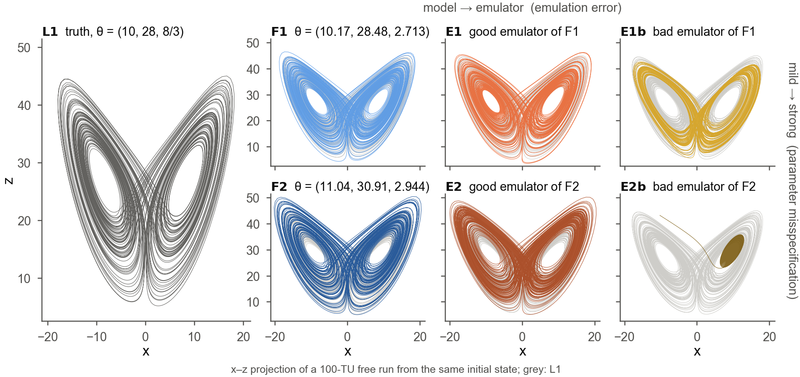
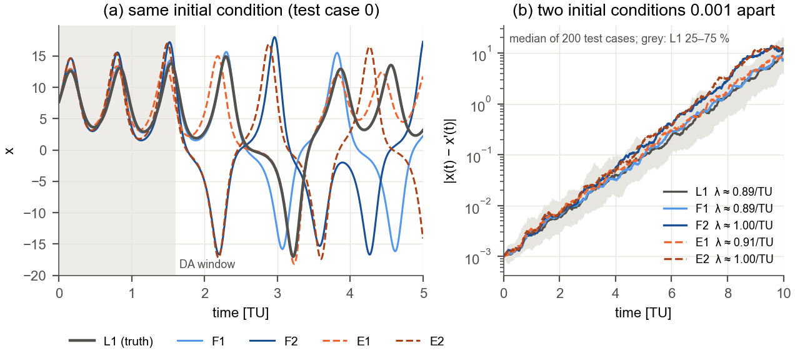
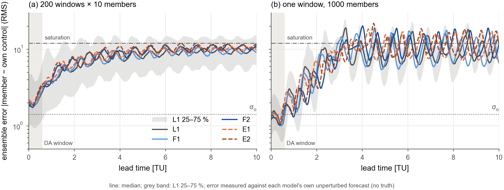
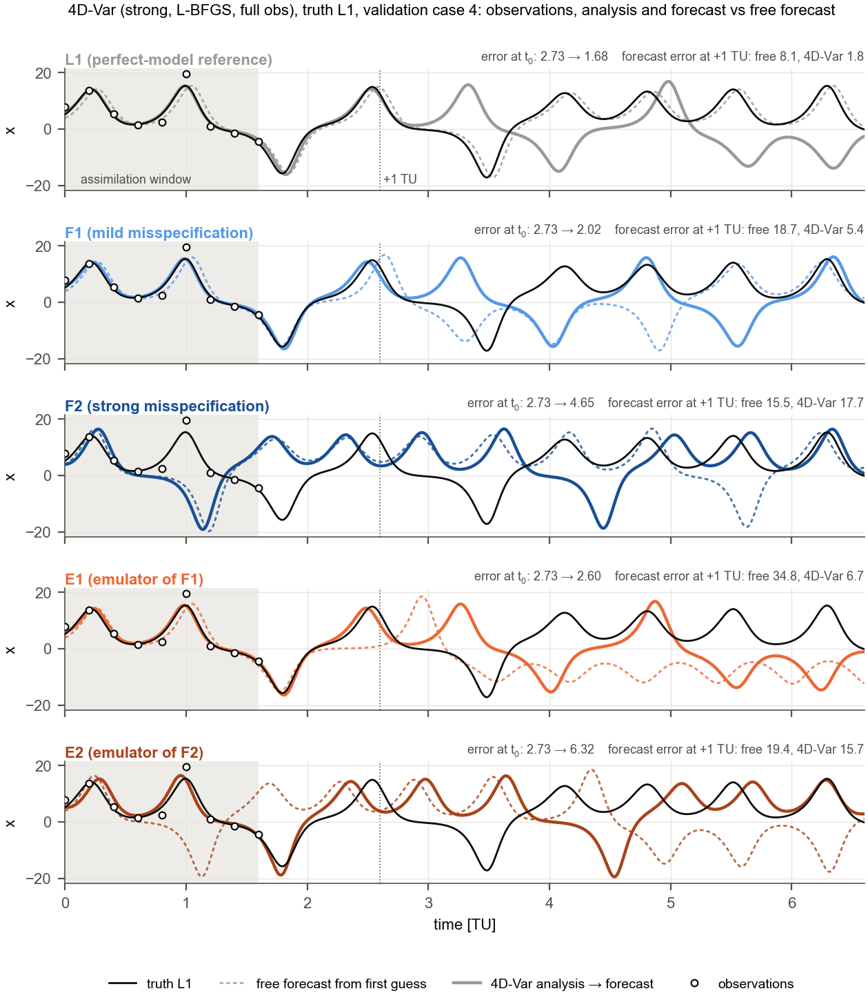
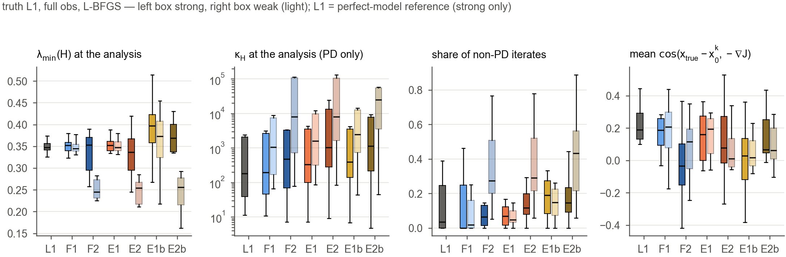
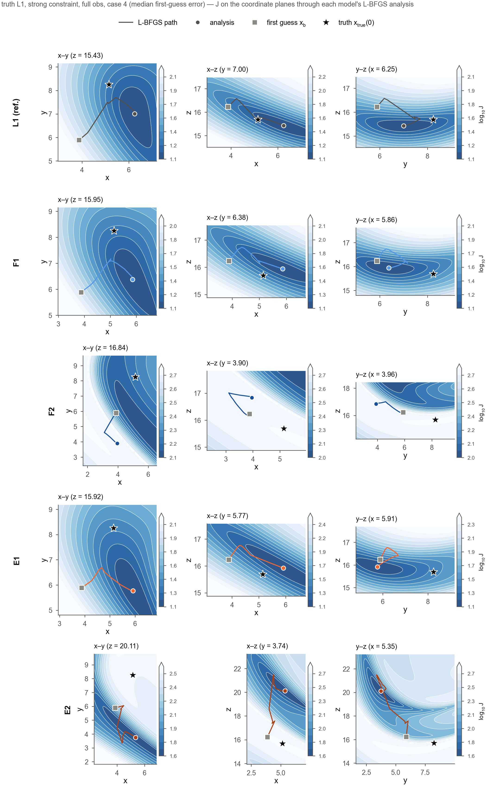

# dameta — 4D-Var under model error, and learning to optimize it

Initial-condition estimation by 4D-Var on Lorenz-63 (L63), with a controlled set of imperfect models.
Two questions: (1) how do **physical misspecification** and **emulator approximation** change the 4D-Var cost and its
solution, and (2) can a learned optimizer learn the geometry of that cost (earlier milestones, §4)?

---

## 1. Models: the model rectangle (branch `m7-model-rectangle`)

```
            F1 ──(emulator approximation)──▶ E1        L1 = truth (observations, evaluation, reference)
            │  (physical misspecification)    │
            F2 ──(emulator approximation)──▶ E2
```

| model | definition | one-interval model error* |
|---|---|---|
| **L1** | L63, σ = 10, ρ = 28, β = 8/3; RK4, Δt = 0.01, float64 | — (truth) |
| **F1** | L63 with θ = θ_L ⊙ (1 + ε d), d = (1,1,1)/√3, ε = 3 % → (10.17, 28.48, 2.713) | 0.155 σ_o (vs L1) |
| **F2** | same direction, ε = 18 % → (11.04, 30.91, 2.944) | 0.958 σ_o (vs L1) |
| **E1 / E2** | MLP tendency (1 hidden layer × 8, SiLU) + RK4, trained on 10 F1 / F2 trajectories | 0.142 / 0.126 σ_o (vs teacher) |

\*RMS of the error accumulated over one observation interval from the true state, / σ_o (pre-registered pick:
F1 ≈ 0.15, F2 ≈ 1, emulators ≈ F1). The mild physical step and the emulator step are therefore of similar size.

All five models keep the butterfly attractor. F2 (and E2) has a visibly larger one.



**Same initial condition (a)** and **two initial conditions 10⁻³ apart (b).** From the same state, the models leave
the truth inside or just after the 1.6-TU assimilation window. Two nearby states separate at the same exponential rate
in every model (λ ≈ 0.89 /TU for L1, F1, E1; ≈ 1.00 /TU for F2, E2).



## 2. Error growth (branch `m7-model-rectangle`)

Truth-free ensemble: members = M^τ(x_true(t₀ − τ) + ε), ε ~ N(0, 2 I), τ = 0.5 TU; error = member − the model's own
unperturbed forecast. (a) 200 windows × 10 members, (b) one window × 1000 members. The four imperfect models grow
errors like the truth and saturate after ~3–4 TU. Shaded: the 1.6-TU assimilation window; the σ_o line is the
m7 perturbation level (σ² = 2).



## 3. 4D-Var on the model rectangle (branch `m8-classic-4dv`, experiment M8-R)

**Problem.** Window 1.6 TU (160 steps), observations every 20 steps (9 times), R = 4 I, H = I (full) or x only.
Strong constraint: control x₀ ∈ ℝ³. Weak constraint: control (x₀, η₁…η₈) ∈ ℝ²⁷ with J_q = ½ Σ ηᵢᵀ Q⁻¹ ηᵢ.

| item | setting |
|---|---|
| first guess x_b | truth model's 0.5-TU lagged forecast valid at t₀ − 5 steps, **shared** by all models of a truth (pure timing error) |
| B | static 3×3 per truth, truth-free: B = E[d dᵀ] − R from t₀ innovations (1000 train cases), used as 4B |
| Q | q_m I per (truth, model), χ²-tuned: median 2J_min / p = 1 (truth-free) |
| optimizers | GD, Adagrad, Adam, L-BFGS (strong-Wolfe); ≤ 1000 iterations, tol 10⁻⁶ |
| diagnostics | exact Hessian at every iterate (λ_min, κ_H, non-PD share), cos(x_true − x₀ᵏ, −∇J), J on coordinate planes |

**Twin stages.** Imperfect model and perfect-model reference use the same observations, x_b and B. Only the dynamics
inside J differ.

| stage | truth = obs | reference (strong) | tested (strong + weak) | isolates |
|---|---|---|---|---|
| A1 | L1 | L1 | F1, F2 | misspecification |
| A2 | F1 / F2 | F1 / F2 | E1, E1b / E2, E2b | emulator approximation alone |
| B | L1 | L1 | E1, E2, E1b, E2b | approximation + misspecification |

E1 / E2 = good emulators (E1g / E2g); E1b / E2b = bad emulators (1 training IC, MLP 1 × 6, 5000 training steps, `e*_d1w6d1s5000`), same
configuration (shared first guess and B, χ²-tuned Q, E1 / E2 learning rates).

**The scheme on one case** (truth L1, strong, L-BFGS, full obs, validation case 4). Each model assimilates the same
9 observations (○) from the same first guess. Thick line: 4D-Var analysis over the window, then its forecast. Dashed:
the same model's free forecast from the first guess (no assimilation). Black: truth. Top-right of each panel: error at
t₀ (first guess → analysis) and forecast error 1 TU after the window. The first guess is the truth 5 steps late, so
the free L1 run follows the truth with a small lag.



**Results: smoke run, 10 validation cases (mean ± std), L-BFGS, full observations.** The 200-case test has not been
run yet.

| stage | truth | model | IC error, strong | IC error, weak | fc RMSE 1 TU, strong | fc RMSE 1 TU, weak | gradients (strong) |
|---|---|---|---|---|---|---|---|
| ref | L1 | L1 | 1.31 ± 0.74 | — | 0.91 ± 0.87 | — | 22 |
| A1 | L1 | F1 | 1.82 ± 0.73 | 1.77 ± 0.57 | 1.72 ± 1.2 | 1.46 ± 1.2 | 25 |
| A1 | L1 | F2 | 5.58 ± 3.3 | 2.41 ± 0.53 | 8.86 ± 4.9 | 5.00 ± 2.0 | 20 |
| B | L1 | E1 | 2.55 ± 0.98 | 2.38 ± 0.86 | 2.41 ± 1.5 | 2.17 ± 1.5 | 22 |
| B | L1 | E2 | 6.06 ± 3.3 | 2.43 ± 0.63 | 9.28 ± 5.8 | 5.49 ± 2.2 | 26 |
| B | L1 | E1b | 3.22 ± 1.2 | 2.68 ± 0.84 | 3.15 ± 1.5 | 2.27 ± 1.3 | 23 |
| B | L1 | E2b | 5.99 ± 3.2 | 2.77 ± 0.87 | 6.94 ± 4.3 | 5.66 ± 4.1 | 32 |
| ref | F1 | F1 | 1.51 ± 0.68 | — | 3.31 ± 4.6 | — | 21 |
| A2 | F1 | E1 | 1.65 ± 0.74 | 1.57 ± 0.77 | 5.24 ± 6.8 | 4.94 ± 6.6 | 21 |
| A2 | F1 | E1b | 2.64 ± 0.76 | 2.00 ± 0.55 | 7.07 ± 6.5 | 4.88 ± 5.2 | 27 |
| ref | F2 | F2 | 1.43 ± 0.70 | — | 4.73 ± 6.2 | — | 27 |
| A2 | F2 | E2 | 1.45 ± 0.70 | 1.61 ± 0.62 | 5.46 ± 6.1 | 5.79 ± 6.8 | 28 |
| A2 | F2 | E2b | 4.31 ± 2.3 | 2.27 ± 1.1 | 7.59 ± 6.0 | 16.5 ± 5.8 | 27 |

IC error = |x_a(0) − x_true(0)|; forecasts are run with the estimation model. All tables (all optimizers, x-only,
paired Δ): `tmp/results/m8r/rect_smoke.md` in the m8 worktree.

**Cost geometry (truth L1, full obs, L-BFGS).** Left box: strong; right box (light): weak.



**Cost landscape, one case (truth L1, strong).** J on the coordinate planes through each model's analysis, with the
L-BFGS path, first guess (■), analysis (●) and truth (★).



## 4. Earlier milestones (D1 v1/v2 settings, details in `memory/findings.md`)

| branch | content |
|---|---|
| `main` (M1) | L63 + RK4, data generator, TL/adjoint and gradient checks |
| `m2-classical-4dvar` | classical 4D-Var with the exact model; Adagrad 70 vs GD 261 gradients to 1 % of J\* |
| `m3-emulator` | 4D-Var through an emulator; a degraded emulator loses the gradient direction near the minimum |
| `m4-meta-b` | Meta-B learned optimizer: 7.4× fewer gradients than Adagrad, forecast +10 % |
| `m5-meta-grid` | meta grid under model error; adjoint-structured learned gradient (cell 8a) ×2.3–2.9 wall-clock at equal quality; no learner beats L-BFGS |
| `m7-model-rectangle` | five-model rectangle, emulator degradation screen, ensemble error growth (§1–2) |
| `m8-classic-4dv` | classical 4D-Var on the rectangle, static B, χ²-tuned Q, Hessian diagnostics (§3) |

## 5. Repository

```
src/dameta/dynamics/   l63.py, emulator.py, models.py (rectangle registry; src/configs/models.yaml)
src/dameta/data/       generate_v2.py, background.py (lagged first guess, static B)
src/dameta/da/         cost.py (strong / weak / BPE), fourdvar.py, gradients.py
src/dameta/meta/       learned optimizers (M4–M5)
src/dameta/eval/       landscape.py (Hessian diagnostics), lyapunov.py
src/                   run_4dvar_v2.py, estimate_b.py, select_q.py, report_rect_4dv.py, fig_rect_4dv.py,
                       fig_models.py, fig_readme_models.py, fig_readme_4dvar.py
src/scripts/           SLURM wrappers and command lists
memory/                constitution, decisions, findings (main + memory/branches/<branch>/)
docs/figures/          figures of this README
```

Environment: conda env `oceanai` (`environment.yaml`). Outputs go to `tmp/` (git-ignored).
Reproduce the model figure: `python src/fig_readme_models.py --data-root <worktree with tmp/data, tmp/emulators>`.

## License

See [LICENSE](LICENSE).
